<p align="center"></p>

<p align="center"><a href="README.md">简体中文</a> | <a href="README_EN.md">English</a></p>

# AI Lock

AI Lock 是一个免费的原生 Swift/AppKit macOS 工具，主要是想用来监视大模型 AI 等工具，监视它们不作恶。（ES 权限没有申请下来，功能暂时不全面）同时集合系统监控、网络诊断、剪贴板管理、快捷启动、多屏协作的时候锁定 DOCK、解决 macos 任务栏图标拥挤、录屏和多显示器辅助功能。支持 macOS 14 或更高版本，仅支持 Apple Silicon（M 系列芯片，arm64）Mac。

本地文件、应用设置和剪贴板记录均保存在本机。应用启动时会尝试从 GitHub 更新公开测速节点目录；其他网络诊断和在线查询会按需连接相应外部服务。

# 有兴趣做跨模型永久记忆的可以一起研究我的另一个项目 [DAOSHI](https://daoshi.me)

## 下载与安装

- [从 GitHub Releases 下载最新版 DMG](https://github.com/laoguzhe/AI-Lock/releases/latest)
- [直接下载 AI Lock DMG](https://github.com/laoguzhe/AI-Lock/releases/latest/download/AILock.dmg)

AI Lock 免费使用，不含订阅或应用内购买。下载 DMG 后打开，将 `AI Lock.app` 拖到“应用程序”文件夹，再从 Launchpad 或 Finder 启动。首次使用屏幕录制、文件搜索或 DockLock 时，macOS 可能会提示授予相应权限。


## 功能详解

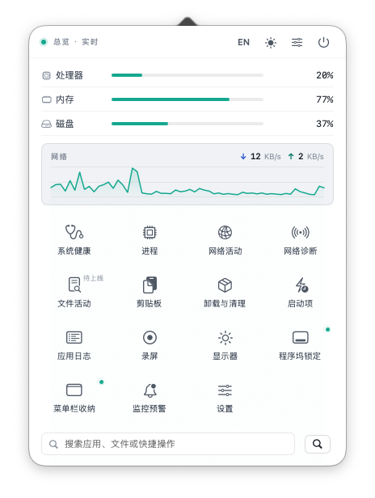

总览面板把 CPU、内存、磁盘和网络概况、功能模块入口及搜索集中在一处；图中数值为截图时的实时状态。

### 系统监控与维护

- **资源总览与预警**：持续采样 CPU、内存、磁盘、网络、交换空间、电池和热状态；可设置阈值与通知。关闭总览窗口后，预警仍可在后台运行；相同类型提醒有冷却时间。
- **进程管理**：查看进程资源占用、监听端口和网络速率；支持搜索、筛选及正常退出或强制结束。执行操作前会再次核对进程身份；批量退出仅针对当前用户的普通应用。
- **系统健康检查**：提供磁盘和内存性能检查，并显示设备与系统信息、风扇转速，以及内置和外置磁盘的名称与用量。测量值受当前设备负载、存储和网络环境影响。
- **缓存清理**：检查由应用维护的用户缓存，展示待处理项并在清理前要求确认。建议先退出相关应用。
- **应用卸载**：检查用户安装的第三方应用及可识别的关联项目；逐项选择后移入废纸篓。系统应用不在卸载范围内。
- **启动项检查**：查看 LaunchAgents、LaunchDaemons 等启动配置及异常线索，包括缺少有效 Label、启动程序缺失或不可执行。对无法解析或异常的当前用户 LaunchAgent，可先备份再移走；系统级项目需通过所属应用或管理员处理。移走配置不等于立即停止正在运行的服务。
- **应用日志**：查看 AI Lock 自身的 macOS Unified Logging 记录，不读取全系统日志。

| 进程管理 | 应用卸载 |
| --- | --- |
| 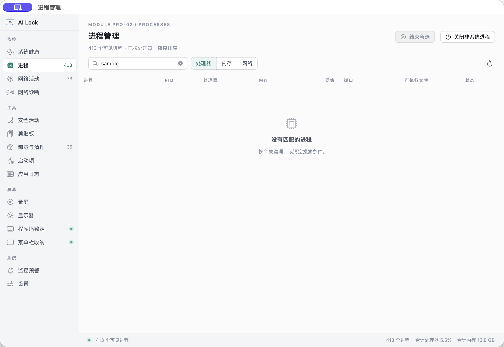 | 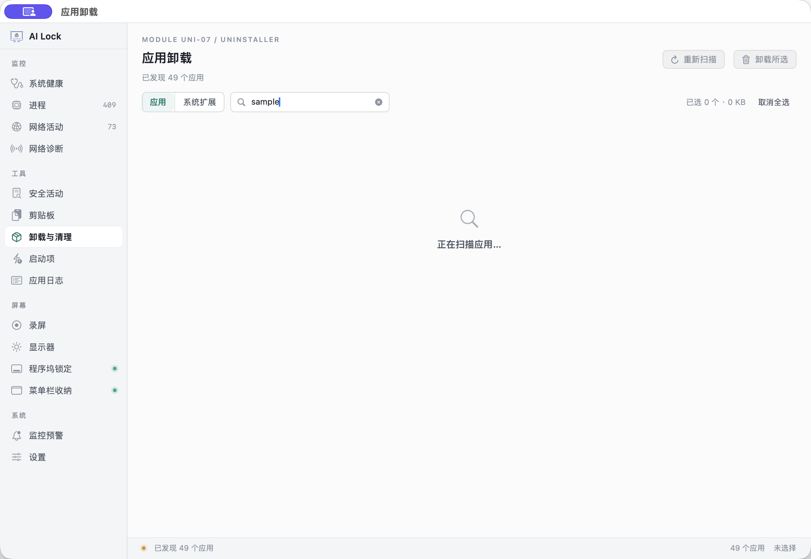 |
| 启动项检查 |  |
| 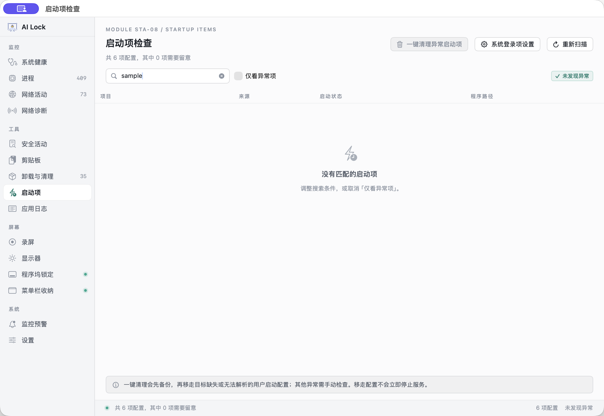 |  |
| 应用日志 |  |
| 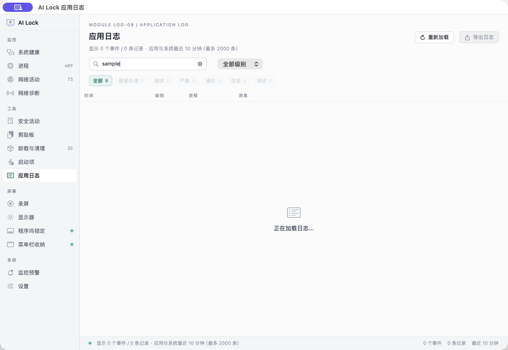 |  |

### 网络活动与诊断

- **网络活动**：观察 TCP/UDP 当前连接和近期变化，按应用、PID、IP、端口、协议或范围筛选；查看连接详情、进程网络速率和应用分组，并导出 CSV。连接按 5 秒间隔采样，短连接可能被漏掉；暂停期间发生的变化无法准确回溯。
- **网络诊断**：运行测速、多节点和网络接口对比、DNS 查询、ICMP 路由追踪、Ping 丢包与抖动、TCP 端口及 IPv6 连通性检查；检查本机 IP、网关、路由和代理信息，并复制或导出报告。
- **自动备用测速**：macOS `networkQuality` 未能返回有效结果时，按所选测速节点尝试备用测试，优先上海电信和 Cloudflare；可分别报告下载成功但上传不可用或未成功的情况，不把下载结果误报为完整双向测速。应用启动时会尝试从公开 GitHub CSV 更新中国电信、联通和移动的节点目录；更新失败时保留上次成功目录并继续使用内置节点。
- **网络过滤准备**：项目包含 Network Extension 内容过滤相关代码和原型配置。系统级过滤需要签名扩展、相应 Apple capability、用户批准和实机验收；默认发行包不承诺提供已启用的全机过滤能力。

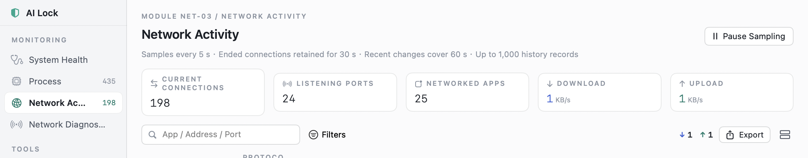

为保护隐私，截图仅展示汇总与筛选区，连接明细已裁去。

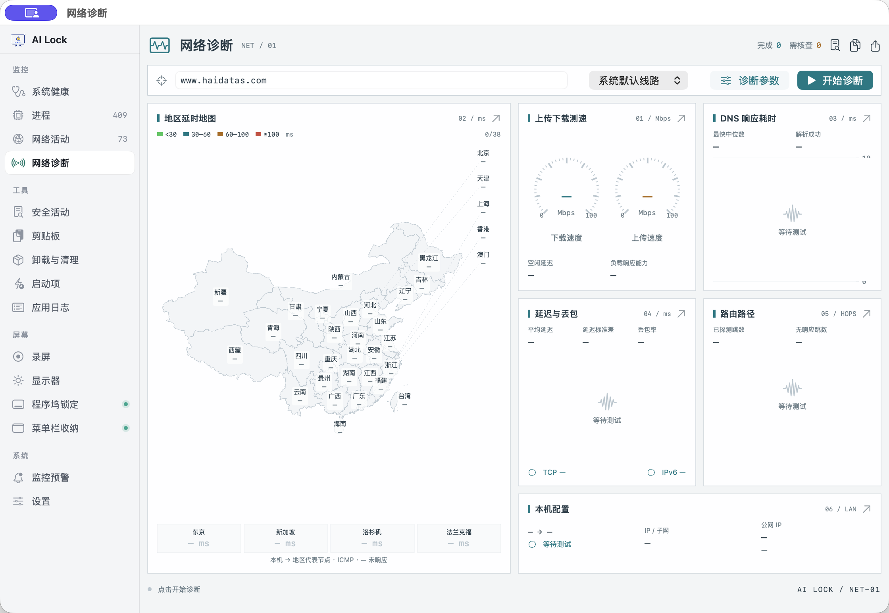

截图展示尚未启动诊断的空状态，不含本机地址或测试结果。

网络诊断会按所选项目连接相应测试端点。启动时的 GitHub 请求只更新测速节点目录元数据；备用测速每个节点最多下载 4 MiB 样本，支持上传的节点会收到 2 MiB 测试数据，不会上传用户文件或剪贴板内容。测速协议由节点决定，部分备用节点使用未加密的 HTTP，节点可看到连接元数据和测试载荷。节点位置可能由 CDN 或 VPN 改变；探测无响应也不一定代表网络故障。

### 文件与 AI 工具活动

本地补充索引包含隐藏文件与文件夹。快捷操作窗口不透明度为 95%，输入与结果之间以细分隔线区分。

- **统一悬浮搜索**：搜索本机应用、Spotlight 可索引的文件和文件夹，以及 AI Lock 快捷操作。结果可在 Finder 中显示或打开；常用目录名称也会在本机建立有限深度缓存。
- **快捷操作条**：双击 Command 打开，可搜索应用、文件和快捷操作，支持键盘选择和最近使用排序。输入 `> 命令` 可主动选择在 Terminal 中运行该命令；普通搜索文字不会自动执行。快捷操作窗口不透明度为 95%。
- **文件活动审计**：提供文件访问事件的筛选、详情和 JSON 导出。Endpoint Security 原型显示的是系统交付的事件元数据；OPEN 不证明读取了文件正文，CLOSE.modified 也不表示捕获到每次写调用。全机审计需要 Apple 批准 Endpoint Security entitlement、签名并激活系统扩展以及用户授权；**默认发行包不包含该扩展，也不保证全机审计**。
- **Agent Hooks**：可为 Claude Code、Codex 和 Cursor 配置 hooks，记录实际经过 hooks 的会话、工具、路径或命令，以及完成、失败或阻止状态；可按规则阻止部分敏感路径写入或危险命令。事件元数据和策略保存在本机，不保存文件正文或工具输出。它只覆盖触发了相应 hook 的调用，不是全机行为监控。

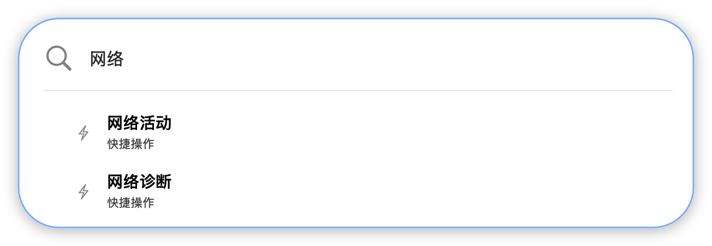

截图展示候选项，不会自动打开模块或执行操作。

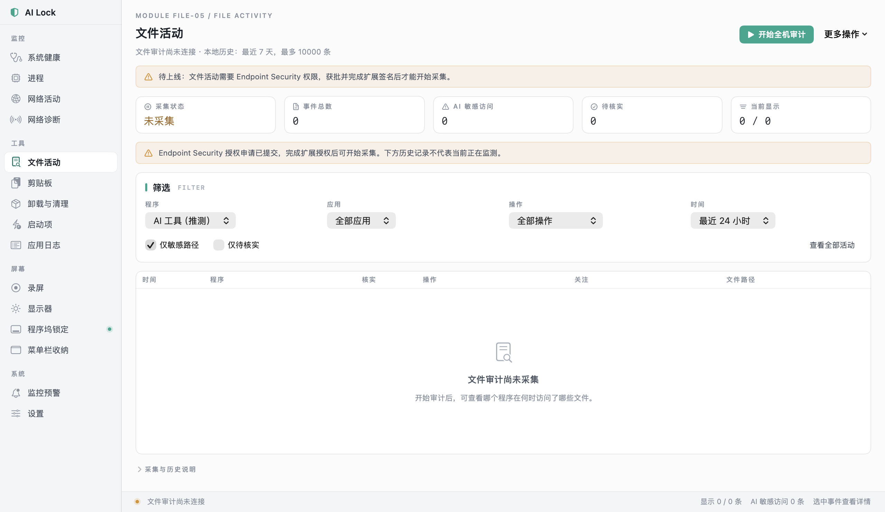

截图展示文件审计尚未连接及 Agent Hooks 接入状态；事件明细未显示。

文件活动功能需要相应授权；扩展状态和限制见[扩展说明](extensions/README.md)。

### 剪贴板

没有内容时可点击「检查剪贴板访问」重试，并按系统提示授权。

- **剪贴板历史**：首次打开模块后开始采集，可暂停、排除指定应用或恢复采集；支持多对象粘贴还原、备注、搜索和加密备份/恢复。
- 历史使用 Keychain 管理密钥、逐记录 AES-GCM 加密并保存在本机 SQLite；默认保留 1–30 天，最多 500 条或 64 MiB，单次复制上限 8 MiB。历史默认不会上传。
- 应用会过滤部分常见 confidential/transient 标志，但不能保证识别所有密码或敏感内容，也不能总是准确判断剪贴板内容的来源应用。请在设置中配置保留时长、排除应用或暂停采集。

### 屏幕、显示器与菜单栏

- **屏幕录制**：选择显示器时会闪烁边框提示，可设置清晰度和保存目录，录制屏幕画面与系统声音，输出 MOV 文件；录制中可查看时长并停止。需在 macOS“隐私与安全性”中允许屏幕与系统录音。录屏快捷键可在设置中配置。


为保护隐私，截图裁去了录制历史并隐藏了本机保存路径；实际录制需要授予屏幕与系统录音权限。

- **显示器控制**：选择一个或多个外接显示器，或全选后调整亮度和扬声器音量。显示器需支持并启用 DDC/CI；部分 HDMI、扩展坞组合不支持。无法确认控制通道时会报告失败。
- **DockLock**：在多显示器环境中限制指针从非目标屏幕边缘进入目标屏幕，并在空闲时将 Dock 指针带回目标屏幕；真实鼠标移动会取消正在进行的回弹。需要辅助功能权限。
- **菜单栏收纳**：把不常用菜单栏图标折叠到箭头左侧，并展开查看；可设置展开后的自动收起行为。
- **屏幕遮罩**：在选定屏幕显示黑色视觉遮罩，至少保留一块屏幕可见；`⌘⌃⇧Esc` 可解除全部遮罩。遮罩不会关闭屏幕，也不会阻止系统或其他应用读取屏幕内容。

| 显示器控制 | DockLock |
| --- | --- |
| 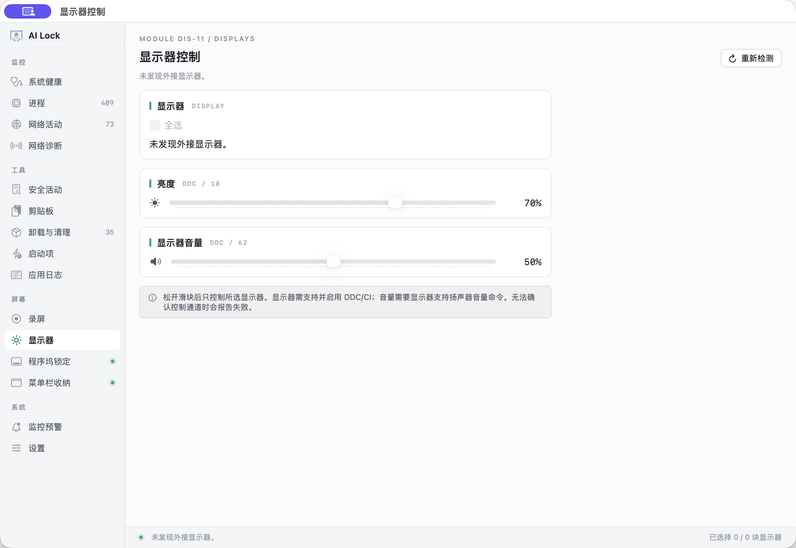 | 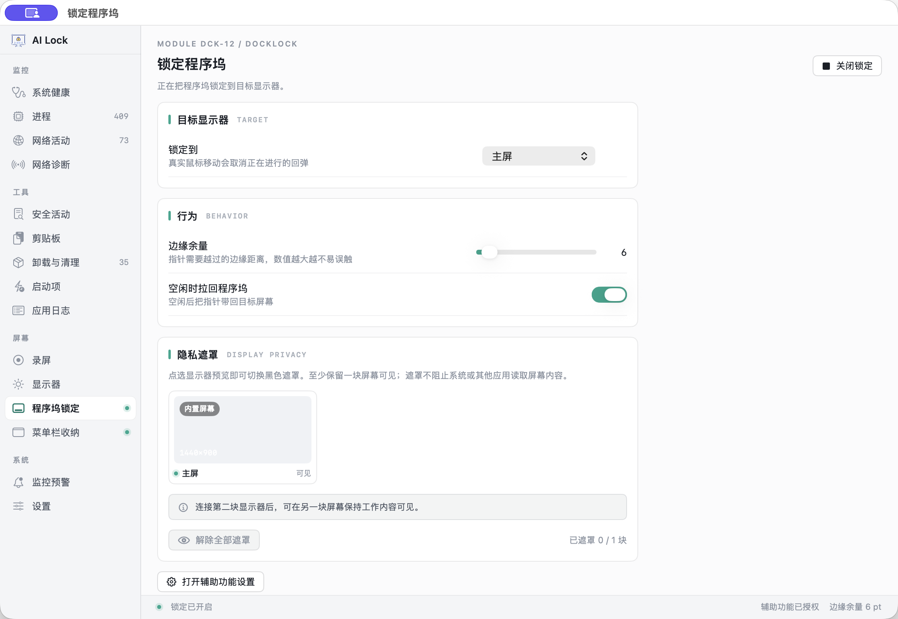 |
| 菜单栏收纳 |  |
| 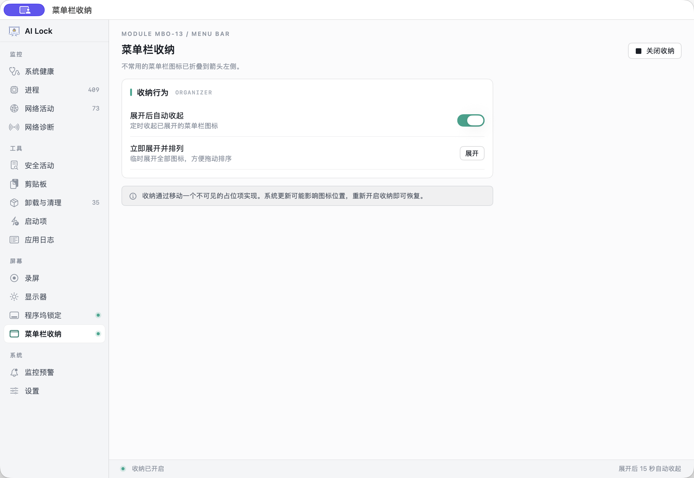 |  |

## 权限与隐私

AI Lock 的常规数据保存在本机。剪贴板历史和 Agent Hooks 事件默认不上传；网络诊断会连接用户选择或配置的测试服务器。部分能力需要用户主动授权：

- **辅助功能**：DockLock 与部分全局快捷键操作需要。
- **输入监控**：部分全局快捷键监听需要；可从应用快捷键设置打开系统授权入口。
- **完全磁盘访问**：用于扩展文件搜索范围；未授权时，应用搜索和快捷操作搜索仍可使用。
- **屏幕与系统录音**：用于屏幕录制。
- **Endpoint Security / Network Extension**：仅系统级审计或过滤功能需要；还取决于 Apple capability 批准、扩展签名与系统授权，不能仅通过授予普通隐私权限启用。

应用不会把“未获授权”伪装成采集成功。删除本地剪贴板历史、文件活动历史或 Agent Hooks 数据，可以在相应模块中操作。请在启用采集前阅读功能说明并选择适合自己的保留时间和范围。

阈值未修改时「保存阈值」为灰色；修改后启用，保存过程中禁用，保存完成后再次禁用。模块切换复用同一个窗口，并保持窗口位置和尺寸。

## 快捷键与设置

在快捷键设置中配置 `⌘⌃1–9` 打开模块；快捷操作支持双击 Command 或 `⌘⌃⌥Space`。统一悬浮搜索默认使用 `⌥Space`。可在设置中调整模块显示和排序、通知阈值、剪贴板保留策略、启动行为及快捷键。

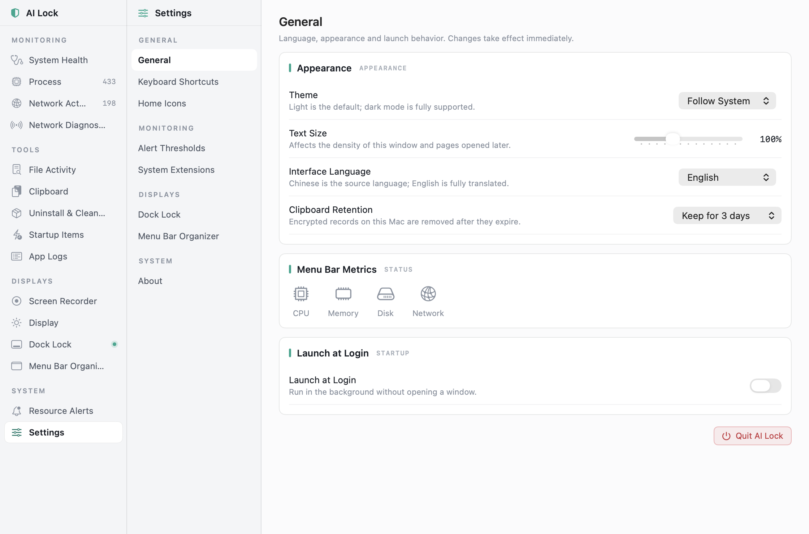

图中仅展示设置界面，具体选项和数值以用户设置为准。

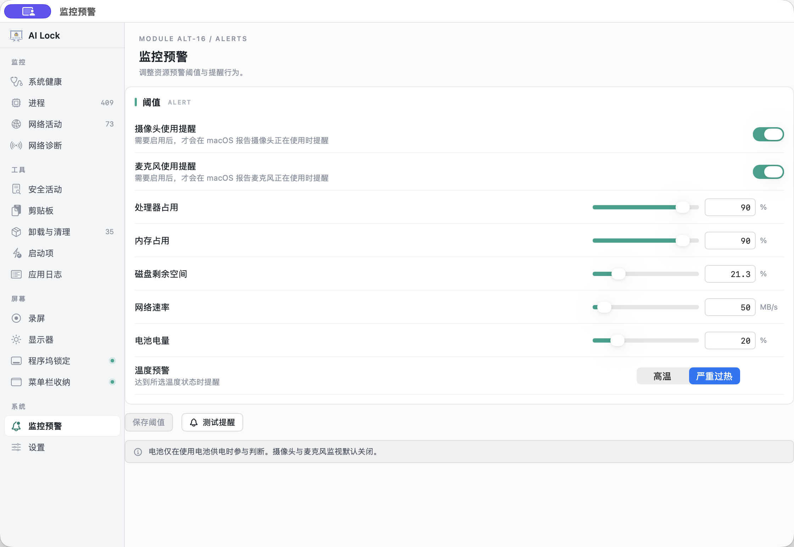

DockLock 也支持通过偏好设置调整边缘距离和目标显示器，例如：

```bash
defaults write com.laogu.ailock edgeMargin -float 6.5
defaults write com.laogu.ailock autoSnap -bool true
defaults write com.laogu.ailock targetDisplay -string builtin # builtin | main | 显示器 ID
```

设置通常会在数秒内重新加载。文件日志位于 `~/Library/Logs/AILock.log`。

## 构建与生成 DMG

需要安装 Xcode Command Line Tools。开发构建和本机 DMG：

```bash
./build.sh
./package-dmg.sh
```

`package-dmg.sh` 会在 `build/package/` 中构建应用并生成 `AILock-<VERSION>-local.dmg`。此本地包不经过 Apple 公证，适合开发和内部试用，不要作为公开下载版。

准备可直接供外部用户下载的签名与公证版：

```bash
./package-dmg.sh --release
```

该命令调用 `release.sh`，需要 Developer ID Application 证书和 `notarytool` 公证配置；会按 [`VERSION`](VERSION) 和 [`BUILD_NUM`](BUILD_NUM) 生成 DMG。应用包内的 `Contents/Resources/LICENSE.txt` 会附上本项目许可证和来源署名。

发布 DMG 需要 Developer ID 签名、公证凭据和已配置的 GitHub CLI。GitHub Release 附件使用固定名称 `AILock.dmg`；仓库必须为公开仓库，应用才能免登录检查更新并下载新版。

完整发布到 GitHub 可运行 `./fabu.sh`：它自动递增 `VERSION` 和 `BUILD_NUM`，构建、签名、公证并验收应用及 DMG，然后执行 `git add -A`、创建发布提交、推送当前默认分支，并创建 GitHub Release 上传 `AILock.dmg`、SHA-256 校验和与 `AILock-update.json` 更新清单。应用启动时会检查清单；发现新版后提示用户，确认后会校验下载文件、替换应用并重新启动。脚本要求仓库为 Public、GitHub CLI 已登录、公证凭据可用且发布标签不存在；运行前请确认仓库内所有已修改和未跟踪文件都应包含在本次发布中。

其他开发检查命令见 [`tests/`](tests/)。真实 Endpoint Security 授权和系统扩展运行仍需已批准的 entitlement 与签名设备验收；本地原型构建不能代替该验收。

## 许可证与来源署名

本项目使用**附来源署名条款的修改版 MIT 许可**，允许免费使用、复制、修改和再分发，包括商业使用；再分发时必须保留许可证，并注明源自 AI Lock。修改版本还应清楚说明做过哪些修改。它不是未经修改的标准 MIT 许可，完整条款见 [LICENSE](LICENSE)。

署名示例：

> Based on AI Lock by 老谷: https://github.com/laoguzhe/AI-Lock

修改版本可补充：`Modified by <name>; changes: <summary>.`

代码主要使用 Swift、AppKit、SwiftUI 和 macOS 系统框架。扩展实现边界见 [`extensions/README.md`](extensions/README.md)。
